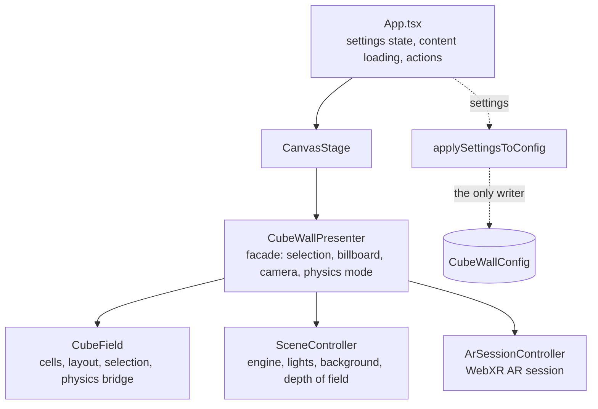
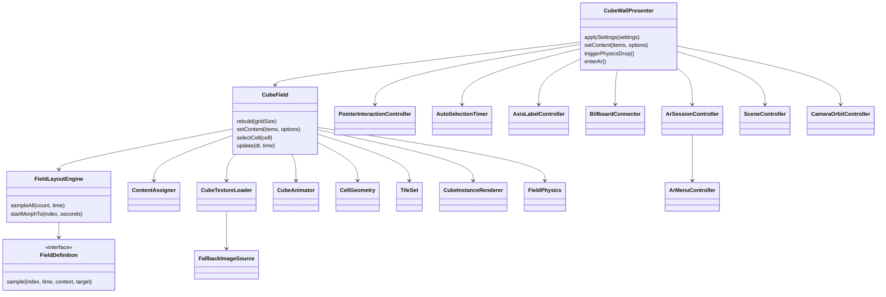

# Architecture

The cube wall is a Babylon.js scene driven by a React shell. React owns settings, content loading and HTML overlays; everything 3D lives under `src/engine/`.

## Layers

`App` never writes the engine config. Settings flow one way: React state → `presenter.applySettings(settings)` → `applySettingsToConfig(settings, config)` (`src/config/applySettingsToConfig.ts`). User actions (keyboard, control panel, AR menu) share one handler, `runAction` in `App.tsx`.

## Classes

| Folder | Responsibility |
|---|---|
| `layouts/` | `FieldLayoutEngine` and one `FieldDefinition` per shape (grid, line, masonry, spiral, sphere, helix, chaos): index → position, cross-fade between two shapes |
| `content/` | `ContentAssigner`: which item goes onto which grid cell (matrix / axis grouping) |
| `cubes/` | per-cell work: `CubeTextureLoader` (atlas, detail texture, UVs, aspect crop), `FallbackImageSource`, `CubeAnimator` (motion without physics), `CellGeometry` (orientation, tile scale), face UV tables |
| `tiles/` | tile mode: `TileSet` (descriptors, footprints), glass caption tiles, tile materials |
| `instancing/` | `CubeInstanceRenderer`: all cubes / image tiles as thin instances with one texture atlas; the cell meshes are invisible proxies |
| `physics/` | `FieldPhysics`: Havok in field space (unaffected by the AR anchor); attractor to the layout, hold in hand, throw |
| `input/` | `PointerInteractionController`: mouse / touch (hover, click vs. camera drag, physics drag, wheel) |
| `selection/` | `AutoSelectionTimer`: kiosk auto-selection |
| `presentation/` | `AxisLabelController` (row / column labels), `BillboardConnector` (line to the HTML billboard) |
| `xr/` | `ArSessionController` (AR session, placement, grabbing, finger touch), `menu/` (AR hand menu: model, paint, panel, controller) |

## Collaboration pattern

Extracted classes do not reach back into their owner. They get either plain values in the constructor or a small **host interface** listing exactly what they may read or call (`CubeTextureHost`, `PointerInteractionHost`, `BillboardConnectorHost`, `ArSessionHooks`). That interface is the contract; if a class needs more, extend the interface deliberately.

## Rules for changes

1. **Design first.** For a new feature, sketch the classes (Mermaid in this file) before writing code. Decide which existing class owns it, or create a new one.
2. **No class grows past ~400 lines.** `CubeField` and `CubeWallPresenter` are facades (~1100 lines each, still too big); new behaviour goes into a focused class next to them, never into them.
3. **One writer per state.** Engine config is written only by `applySettingsToConfig` (settings) and by the class that owns a runtime value (e.g. `CubeField.setContent` sets `config.layout`). React state is the source for settings.
4. **Same action, one path.** New user actions are added to `ControlAction` / `ArMenuAction` and handled in `runAction`; keyboard, control panel and AR menu call it.
5. **Behaviour-preserving refactors are verified** with the regression run (layout, morph, physics modes, tiles, selection, textures) before committing; see `README.md`.

## Planned: field and activation-front system

Transitions become a `TransitionSpec` of source field, target field, a slot assignment (cubes claim the nearest free slot instead of keeping their index) and an `ActivationFront` (plane, sphere, curve) that decides when each cube starts. A `MotionBackend` runs it: GPU (vertex shader, no physics), CPU kinematic, or physics (attractor + collisions). Fields and fronts provide both a TypeScript and a GLSL form so the GPU and CPU paths stay identical.
